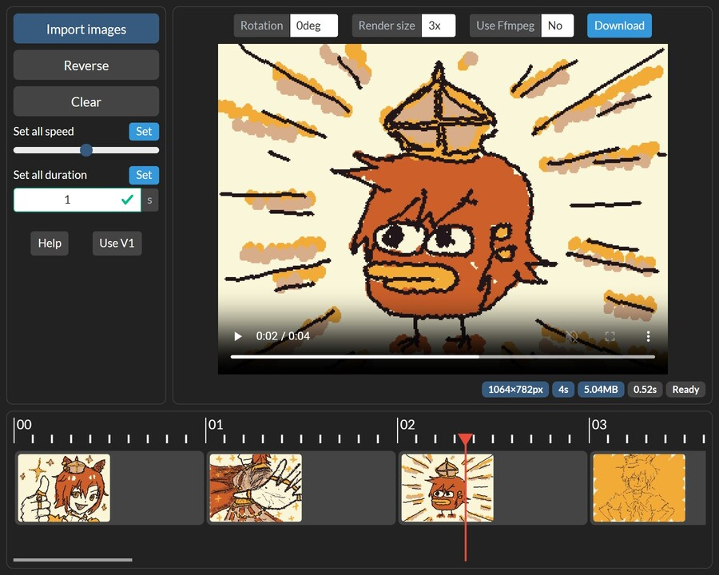

# wiggly-compose-gif

Created out of the desire to compose an MP4 video out of a series of GIFs,
drawn (shoddily) on [WigglyPaint](https://beyondloom.com/tools/wigglypaint.html#main).
WigglyPaint is made by [internet janitor](https://beyondloom.com/about/index.html).

> [!NOTE]
> If you enjoy using WigglyPaint, please take a moment to read
> [the latest blog post from the WigglyPaint author](https://beyondloom.com/blog/onwigglypaint.html).

## Usage

1. [Draw!](https://beyondloom.com/tools/wigglypaint.html#main) Then export the GIFs
1. Load up the images you want to compose into a video
1. Rearrange, and edit the duration desired per image
1. Choose render size and rotation as desired
1. If the MP4 video is not playable, consider using the lossless reencode with FFmpeg
1. Video is auto-composed and can be downloaded as needed

## Made with

- React (I was lazy)
- Bootstrap (very much so)
- `omggif` and `mp4-muxer`, to parse GIFs into image data and compose into a video
  - Yep I know `mp4-muxer` is deprecated, but it just works
- `@hello-pangea/dnd` for beautiful drag and drop interaction
- `@floating-ui/react` for hover effects
- `@ffmpeg/ffmpeg` WASM as fallback when the WebCodecs misbehave
- `zustand` for easier state management
